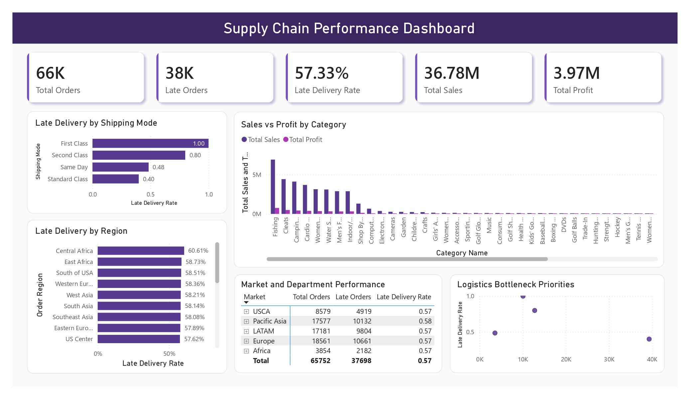

# 🚚 Supply Chain & Logistics Analytics

### DataCo Smart Supply Chain | End-to-End Data Analytics Project


> A data-driven investigation of shipping delays, fulfillment performance, and product profitability using the original **DataCo Smart Supply Chain dataset**.

---

## 📌 Project Overview

This project analyzes supply chain operations to identify delivery delays, operational bottlenecks, and product categories with weaker profitability.

Using the DataCo Smart Supply Chain dataset, the analysis combines Python and Pandas for data preparation and exploration, SQL Server for business analysis, and Power BI for performance reporting.

The goal is to help management understand **where fulfillment performance is falling short, what deserves investigation first, and which actions can improve logistics operations**.

### Dataset at a Glance

| Metric | Dataset result |
|---|---:|
| Item-level records | 180,519 |
| Distinct orders | 65,752 |
| Product categories | 50 |
| Departments | 11 |
| Markets | 5 |
| Order date range | Jan 1, 2015 – Jan 31, 2018 |
| Orders later than scheduled shipping duration | 37,698 |
| Late-order rate | 57.33% |

*Delivery metrics are calculated at distinct-order level. An order is classified as late when its actual shipping duration exceeds its scheduled shipping duration.*

---

## 🎯 Business Problem

Supply chain delays can affect customer experience, operational efficiency, and profitability. Overall performance figures, however, can hide specific problems by shipping mode, geography, department, or product category.

This project investigates five business questions:

1. Which shipping modes and regions experience the most late deliveries?
2. Which product categories generate high sales but relatively low profit?
3. How are shipping delays associated with order profitability?
4. Which markets or departments have recurring fulfillment issues?
5. Where should management investigate logistics bottlenecks first?

The analysis distinguishes between **delay rate** and **late-order volume**. A high rate in a small group may require attention, while a lower rate across a large group can create a greater operational workload.

---

## 🔎 Key Findings

### 1. Shipping-mode performance is uneven

| Shipping Mode | Orders | Late Orders | Late Rate |
|---|---:|---:|---:|
| First Class | 10,079 | 10,079 | **100.00%** |
| Second Class | 12,778 | 10,213 | **79.93%** |
| Same Day | 3,571 | 1,727 | **48.36%** |
| Standard Class | 39,324 | 15,679 | **39.87%** |

First Class has a 100% late rate under the dataset's actual-versus-scheduled duration definition. Its average scheduled duration is 1 day, compared with an average actual duration of 2 days. Second Class also shows a substantial mismatch: average actual shipping is approximately 4 days against a 2-day schedule.

**Interpretation:** The First Class and Second Class results warrant an immediate review of service-level assumptions, shipping-duration definitions, and carrier performance. The figures do not, by themselves, prove which cause is responsible.

### 2. Western Europe has the largest regional late-order count

| Order Region | Orders | Late Orders | Late Rate |
|---|---:|---:|---:|
| Western Europe | 10,010 | **5,842** | 58.36% |
| Central America | 9,396 | 5,394 | 57.41% |
| Southeast Asia | 4,356 | 2,530 | 58.08% |
| Oceania | 4,362 | 2,481 | 56.88% |
| Northern Europe | 3,716 | 2,087 | 56.16% |

Western Europe is the first regional area to investigate by **late-order volume**. Central Africa has the highest regional late rate at 60.61%, but this is based on 556 orders and 337 late orders.

**Interpretation:** Use both rate and volume when prioritizing regions. Western Europe represents the largest observed delay workload in this comparison; Central Africa is a smaller but high-rate area to examine.

### 3. High sales do not always mean strong profit margin

The dataset-wide sales total is **$36.78M**, and the summed `Order Profit Per Order` field is **$3.97M**, producing an overall margin proxy of **10.78%**.

| Product Category | Sales | Profit | Profit Margin |
|---|---:|---:|---:|
| Fishing | $6,929,654.00 | $756,220.77 | 10.91% |
| Cleats | $4,431,943.00 | $494,636.92 | 11.16% |
| Camping & Hiking | $4,118,426.00 | $427,455.57 | **10.38%** |
| Cardio Equipment | $3,694,843.00 | $383,011.10 | **10.37%** |
| Water Sports | $3,113,845.00 | $325,146.96 | **10.44%** |
| Shop By Sport | $1,309,522.00 | $129,813.96 | **9.91%** |

Camping & Hiking, Cardio Equipment, Water Sports, and Shop By Sport each generate sales above the average category sales level while showing margins below the dataset-wide 10.78% margin proxy.

Strength Training is a separate low-margin signal: **$54,895.53 sales**, **$332.31 profit**, and a **0.61% margin**.

**Interpretation:** Review discounting, product costs, fulfillment expenses, and pricing for these categories. The available fields do not isolate the exact cause of low margin.

### 4. Late orders show lower average order profit in this dataset

| Delivery Group | Orders | Average Order Sales | Average Order Profit |
|---|---:|---:|---:|
| Not late | 28,054 | $561.76 | $61.84 |
| Late | 37,698 | $557.73 | $59.21 |

Orders classified as late have a lower average order-profit value in this dataset. This is an observed association, not proof that the delay caused the difference.

The dataset does not include a customer review-score field. Therefore, customer satisfaction cannot be directly compared between late and on-time orders using this file alone.

---

## 💡 Recommendations

Recommendations below are tied to the measured results and are intended as investigation priorities—not claims of proven root cause.

### Priority 1 — Review First Class and Second Class delivery commitments

- First Class has **10,079 late orders out of 10,079** under the actual-versus-scheduled duration definition.
- Its average scheduled duration is 1 day, while average actual duration is 2 days.
- Second Class has a **79.93%** late rate, with average actual duration of approximately 4 days versus a 2-day schedule.

**Recommended action:** Validate the service-level definitions and scheduled delivery assumptions first. Then compare carrier-level performance, dispatch timing, and route-level execution before changing delivery promises.

### Priority 2 — Start regional investigation with Western Europe

Western Europe records **5,842 late orders** across 10,010 orders, a **58.36%** late rate.

**Recommended action:** Break this region down by shipping mode, department, and order country/state where available. Compare each segment's order volume and delay rate to locate the specific combinations driving the regional result.

### Priority 3 — Review high-sales, below-average-margin categories

Camping & Hiking, Cardio Equipment, Water Sports, and Shop By Sport exceed average category sales while having margins below the dataset-wide margin proxy of **10.78%**.

**Recommended action:** Investigate discounts, product cost structure, and fulfillment-related costs for these categories. Treat Strength Training as a separate margin-risk category because its measured margin is only **0.61%**.

### Priority 4 — Prioritize by both late rate and late-order count

Standard Class has a lower late rate (**39.87%**) than First Class and Second Class, but it accounts for **15,679 late orders**, the highest count among shipping modes.

**Recommended action:** Maintain a two-track review:
- High-rate service modes: First Class and Second Class
- High-volume workload: Standard Class

This avoids focusing exclusively on the largest percentage or exclusively on the largest number.

### Priority 5 — Track delivery and profitability together

Late orders have an average order-profit value of **$59.21**, compared with **$61.84** for orders not classified as late.

**Recommended action:** Monitor delay rate, late-order volume, and order profit together after operational changes. Use a review-score dataset or a customer-experience source before making satisfaction claims.

---

## 🔄 Project Workflow

```text
Business Problem
      ↓
Dataset Understanding
      ↓
Data Quality Checks
      ↓
Data Cleaning & Preparation
      ↓
Exploratory Data Analysis (EDA)
      ↓
SQL Business Analysis
      ↓
Root Cause Investigation
      ↓
Power BI Dashboard
      ↓
Evidence-Based Recommendations
```

### 1. Dataset Understanding
- Inspect dimensions, field names, data types, and missing values.
- Identify item-level versus order-level attributes.
- Validate shipping-duration and financial-field definitions.

### 2. Data Cleaning & Preparation
- Check duplicate item identifiers and order identifiers.
- Convert shipping durations and financial columns to numeric types.
- Create a late-delivery flag from actual and scheduled shipping durations.
- Preserve order-level and item-level grains for the correct analyses.

### 3. Exploratory Data Analysis
- Analyze shipping modes, regions, markets, and departments.
- Compare sales, profit, and margin by category.
- Identify groups with elevated delay rates and high late-order volume.

### 4. SQL Analysis
- Calculate distinct orders and late orders.
- Compare delivery performance across operational dimensions.
- Aggregate product sales and profit at the appropriate item/category grain.
- Validate key findings against the Pandas analysis.

### 5. Root Cause Investigation
- Break down high-delay shipping modes by market and region.
- Investigate regions with high delay volume.
- Examine categories with high sales and below-average margins.
- Separate observed patterns from causal conclusions.

### 6. Power BI Dashboard
Create an interactive dashboard for delivery performance, category profitability, and bottleneck prioritization.

### 7. Recommendations
Prioritize operational reviews based on validated delay rate, late-order volume, and financial impact.

---

## 🧰 Tools & Technologies

| Tool | Purpose |
|---|---|
| Python | Data analysis |
| Pandas | Data cleaning, grouping, aggregation, and EDA |
| SQL Server / SSMS | SQL business analysis and validation |
| Power BI | Interactive dashboard and KPI reporting |
| Jupyter Notebook | Analysis environment and documentation |
| GitHub | Project version control and portfolio |

---

## 📊 Power BI Dashboard

The dashboard is designed around the questions management needs to answer.



---

## 🗂️ Project Structure

```text
supply-chain-logistics-analytics/
├── data/
│   └── DataCoSupplyChainDataset.csv
├── notebooks/
│   └── supply_chain_analysis.ipynb
├── sql/
│   └── supply_chain_analysis.sql
├── powerbi/
│   └── supply_chain_dashboard.pbix
├── images/
│   └── dashboard-screenshot.png
└── README.md
```

---

## 📁 Dataset

**Dataset:** DataCo Smart Supply Chain for Big Data Analysis

- [Kaggle dataset](https://www.kaggle.com/datasets/shashwatwork/dataco-smart-supply-chain-for-big-data-analysis)
- [Mendeley Data publication](https://data.mendeley.com/datasets/8gx2fvg2k6/1)

The analysis uses the original `DataCoSupplyChainDataset.csv` file.

### Important Fields

| Field | Description |
|---|---|
| `Order Id` | Order identifier |
| `Order Item Id` | Item-level record identifier |
| `Shipping Mode` | Shipping service mode |
| `Market` | Business market |
| `Order Region` | Geographic region |
| `Department Name` | Department |
| `Category Name` | Product category |
| `Days for shipping (real)` | Actual shipping duration |
| `Days for shipment (scheduled)` | Scheduled shipping duration |
| `Sales` | Sales amount |
| `Order Profit Per Order` | Profit value recorded for the order-item record |
| `Order Item Quantity` | Quantity of items |

---

## ⚠️ Data & Methodology Notes

- The CSV contains **180,519 item-level records** and **65,752 distinct orders**.
- Delivery metrics are calculated at distinct-order level to avoid counting multi-item orders more than once.
- A delivery is classified as late when `Days for shipping (real)` is greater than `Days for shipment (scheduled)`.
- No shipping-duration values were missing in the uploaded source file.
- Category sales and profit are aggregated from item-level records.
- The category margin shown is a **profit-to-sales ratio based on the dataset's `Order Profit Per Order` field**. It should be interpreted as a dataset-derived margin proxy, not independently audited accounting profit.
- Customer review scores are not present in this dataset; customer satisfaction conclusions are not made.
- Observed relationships are not interpreted as proof of causation.
- The data covers historical orders from 2015 through January 2018 and should not be assumed to describe current operations.

---

## 👤 Author

**Habibur Rahaman**  
Aspiring Data Analyst | Python | Pandas | SQL | Power BI

- [LinkedIn](https://www.linkedin.com/in/habiburrahamankolkata)
- [GitHub Portfolio](https://github.com/habibur-rahaman-data-analytics)
